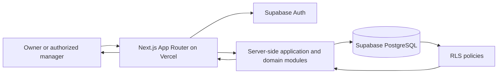

# Web Application Architecture

## Status

**Implemented prototype architecture through Phase 5, with Phase 6 checks underway.** The submitted `prd.md` remains the requirements reference. This document records the current application design; Phase 7 deployment remains separate work.

## 1. Architecture decision

Use a **modular monolith**: one Next.js application deployed on Vercel, with Supabase providing authentication and PostgreSQL. Keep the prototype in one deployable codebase. Do not add a separate backend service or ML service for the current scope.



Row Level Security (RLS) is enforced by PostgreSQL. The Next.js server also authenticates and validates each request. UI visibility is not an authorization control.

## 2. Technology stack

| Area | Choice | Responsibility |
|---|---|---|
| Web framework | Next.js App Router with TypeScript | Pages, layouts, server rendering, forms, and server-side application logic. Use the latest stable release when the app is bootstrapped and commit the lockfile. |
| Hosting | Vercel | Preview deployments for review and a production deployment for the accepted prototype. |
| Database | Supabase PostgreSQL | Persist users' business profiles, transactions, obligations, settings, and optional alert history. |
| Authentication | Supabase Auth | Email/password signup and sign-in with cookie-backed sessions. Immediate signup is enabled for the development prototype. |
| Supabase integration | `@supabase/supabase-js` and `@supabase/ssr` | Create separate browser/server clients where needed and support cookie-based SSR sessions. |
| Live updates | Supabase Realtime | Refresh the authorized workspace after another account changes shared business records. |
| Authorization | PostgreSQL RLS, plus server-side authorization checks | Owners control settings and invitations; managers have limited access to their shared business. |
| Styling | Tailwind CSS v4 | Responsive layouts and component styling. |
| UI primitives | shadcn/ui | Accessible, locally owned components for forms, dialogs, menus, and alerts. Customize them using the product's design tokens. |
| Icons | Lucide React | Consistent interface icons; pair icons with text for important status/actions. |
| Animation | CSS transitions for basic feedback | Keep motion limited to focus, hover, menu/dialog, and save feedback. Add Motion only if a later interaction needs it. |
| Charts | Deferred | FR-08 is Should; select a chart package only if the trend chart is accepted into the MVP. |

Pin dependency versions and commit the package manager lockfile. Never expose a Supabase service-role/secret key through a `NEXT_PUBLIC_` variable or client component.

## 3. Application architecture

### 3.1 Next.js rendering and request handling

- The current dashboard, transaction, obligation, and projection views use Client Components. Their live data is loaded through server-side Supabase queries exposed by a Server Action; owner-only routes also check access in a Server Component.
- Use Server Actions for first-party form mutations where a separate public API is not needed.
- Every Server Action must validate input and verify the current user's identity and permission. Server Actions are callable over the network and must be treated as endpoints.
- Use Route Handlers only for a concrete HTTP integration need, such as a webhook or a future external client. The MVP has no such integration requirement.
- Use Client Components only for interactive portions that need browser state, such as a date-range picker or a chart. Keep database credentials and privileged logic on the server.
- Follow the current Next.js/Supabase cookie-session refresh convention for the installed framework version (currently documented by Supabase using Next.js Proxy). Do not rely on a stale middleware recipe.

### 3.2 Domain logic

Keep business calculations in small, deterministic TypeScript modules with no React or database dependencies. Server Actions/loaders fetch authorized records, pass normalized values to these modules, and return/display the results.

Initial domain modules:

- Cash summaries: realized inflows, realized outflows, period net cash movement, and current balance.
- Obligation balance: original amount less recorded payments/receipts; validate overpayment or overcollection.
- Projection: horizon, recurring net-flow assumption, and future obligation components for scheduled and conservative scenarios.
- Alerts: threshold and due-date rule evaluation, including rule, triggering date, and relevant values.

The projection and alert modules must return their assumptions and data-adequacy state alongside the result. A cash difference must not be labeled accounting profit. No model inference or credit decision belongs in this version.

### 3.3 Data access and mutations

Recommended mutation flow:

1. A user submits a form in the Next.js UI.
2. A Server Action parses and validates the submitted values.
3. The action verifies the user's session and business role.
4. The server Supabase client performs the operation. PostgreSQL RLS independently checks the row/business membership.
5. The action returns a clear success/error result and the refreshed workspace; client providers update their displayed data.

Do not trust a `business_id`, role, amount, or status supplied by the browser without checking it against the authenticated user and current database state. Use Postgres constraints for data invariants where appropriate, in addition to form validation.

## 4. Proposed project structure

```text
Web/
├── app/
│   ├── (auth)/
│   │   ├── login/page.tsx
│   │   └── ...
│   ├── (dashboard)/
│   │   ├── layout.tsx
│   │   ├── dashboard/page.tsx
│   │   ├── transactions/page.tsx
│   │   ├── obligations/page.tsx
│   │   ├── projection/page.tsx
│   │   └── settings/page.tsx
│   ├── actions/
│   │   ├── transactions.ts
│   │   ├── obligations.ts
│   │   └── settings.ts
│   ├── layout.tsx
│   ├── page.tsx
│   └── globals.css
├── proxy.ts                # Supabase session refresh for current Next.js convention
├── components/
│   ├── ui/                 # shadcn/ui components
│   ├── navigation/
│   ├── dashboard/
│   ├── transactions/
│   ├── obligations/
│   └── feedback/           # empty, loading, error, and success states
├── features/
│   ├── cashflow/
│   │   ├── calculations.ts
│   │   ├── projections.ts
│   │   └── alerts.ts
│   ├── transactions/
│   │   ├── queries.ts
│   │   ├── schema.ts
│   │   └── types.ts
│   ├── obligations/
│   └── settings/
├── lib/
│   ├── supabase/
│   │   ├── server.ts
│   │   ├── browser.ts       # add only if a browser client is needed
│   ├── auth/
│   ├── formatters/
│   └── validation/
├── supabase/
│   ├── migrations/
│   └── seed.sql             # synthetic demo data only
├── public/
├── types/
│   └── database.ts          # generated/maintained Supabase types
├── .env.example             # variable names only; no secrets
├── next.config.ts
├── package.json
└── ARCHITECTURE.md
```

This is a starting structure, not a requirement to create every directory up front. Prefer adding a module when its feature is implemented. Keep components grouped by feature once the UI grows; avoid putting all application logic into `app/` route files.

## 5. Routes and navigation

Proposed authenticated routes:

| Route | Purpose |
|---|---|
| `/dashboard` | Current balance, selected-period summary, active warnings, and entry points to core tasks. |
| `/transactions` | List, add, and correct realized inflows/outflows. |
| `/obligations` | View and manage payables/receivables, partial settlement, and due dates. |
| `/projection` | Review 7/14/30-day projections, scenarios, assumptions, data gaps, and warnings. |
| `/settings` | Set opening balance, cash threshold, and default projection horizon. |
| `/login` | Authentication entry point; exact method TBD. |

The mobile navigation can use a compact menu or bottom navigation after usability review. Keep the same route/permission model across screen sizes.

## 6. Supabase data model

Each business has one owner and may have authorized managers. An account belongs to at most one business through the application flows. Existing owner records remain in `businesses.owner_id`; manager access is recorded in `business_members`.

| Table | Main purpose |
|---|---|
| `businesses` | Business owner, name, opening balance, cash threshold, and default horizon. |
| `business_members` | Managers authorized to work in one business. Owners are identified by `businesses.owner_id`. |
| `business_invites` | Hashed one-time invitation codes, expiration, use, and revocation state. |
| `transactions` | Realized cash entries in integer Rupiah, including linked obligation payments. |
| `obligations` | Payables and receivables with a separate obligation date and due date; remaining balances are derived from linked payments. Owner and manager corrections cannot reduce the amount below payments already recorded. |

Design the schema so a payment/receipt cannot be counted twice as both a realized transaction and a future obligation. Store monetary amounts as integer Rupiah per the PRD. Use explicit date semantics and timezone handling; confirm whether business event dates are stored as `date` or timestamp before migration.

### RLS policy approach

- Enable RLS on every exposed application table.
- Check access through business ownership/membership, not merely the fact that a request is authenticated.
- Allow owner-only operations for business settings, invitations, access management, and the projection page.
- Allow managers to read their business summary and warnings, record/correct transactions, and record obligations/payments.
- Add `USING` and `WITH CHECK` conditions to update policies so users cannot move rows to another business.
- Test both allowed and denied paths, including a user attempting to access another business's UUID.
- Avoid `SECURITY DEFINER` database functions unless a reviewed use case requires them.

The checked-in migrations contain the actual policy SQL. Invitation redemption uses one narrowly scoped `SECURITY DEFINER` RPC because a manager must present a secret code without being able to read the invitation table. It checks `auth.uid()`, expiration, single use, and existing business access. Other data policies use RLS.

## 7. Styling and interaction

- Tailwind CSS v4 utilities with CSS-variable design tokens in `app/globals.css`.
- shadcn/ui primitives for accessible interactive components; keep the component source in the repository and adapt it to the product design.
- Consistent tokens for foreground/background, muted text, borders, spacing, radius, and warning/success states.
- Use explicit text labels in addition to color for warning and status states.
- Start with CSS transitions for basic interaction feedback. Keep financial values visually stable; do not animate balance count-ups.
- Respect `prefers-reduced-motion`. Add the Motion library only if a concrete interaction cannot be served well by CSS.
- Use a chart package only if the optional trends feature is approved; chart values must match the cash summary source.

## 8. Environments and deployment

### Local development

- Use a local `.env.local` for Supabase project URL and publishable key; keep it out of version control.
- Keep a committed `.env.example` with variable names and descriptions, never real values.
- Prefer a dedicated Supabase development project and synthetic seed data. Do not use survey participant data as seed data.
- Record database schema changes as reviewed Supabase migrations in `supabase/migrations/`.

### Vercel deployments

- Connect the repository to Vercel for preview and production deployments.
- Configure environment variables separately for local, preview, and production contexts.
- Use a separate Supabase project for production if production-like data is introduced; do not point previews at a real-data production database.
- Review preview deployments using synthetic data before promoting a build.
- No payment processing, financial integrations, scheduled background jobs, or public external API is required for the MVP.

## 9. Observability and error handling

- Show actionable, non-technical UI messages for validation errors, missing data, and temporary failures.
- Keep server logs free of transaction descriptions, authentication tokens, and unnecessary personal data.
- Distinguish expected business-rule outcomes (such as insufficient history) from system errors.
- Record enough information to diagnose a failed request without logging sensitive financial inputs.
- Decide whether warning history is a product requirement; if it is not, calculate current warnings from current data rather than storing duplicate state.

## 10. Decisions and remaining evaluation

1. **Manager access:** Separate email/password account, joined by an owner-generated one-time code. Managers do not see the projection or settings pages.
2. **Authentication:** Immediate email/password signup for the development prototype. Email confirmation and recovery need a delivery decision before real-data use.
3. **Cash rules:** The current formulas and alert windows are in `CASH_RULES.md`.
4. **Data semantics:** Actual payments are linked transactions; remaining obligations are derived, avoiding duplicate cash counting.
5. **Evaluation:** Phase 6 must check functional requirements, performance, and usability against the submitted PRD.

Resolve these decisions before finalizing migrations or relying on the affected behavior in the UI.

## 11. References

- Product scope and requirements: [`prd.md`](./prd.md)
- [Next.js CSS and styling options](https://nextjs.org/docs/pages/getting-started/css)
- [Next.js mutations and Server Action security](https://nextjs.org/docs/app/getting-started/mutating-data)
- [Supabase SSR client setup for Next.js](https://supabase.com/docs/guides/auth/server-side/nextjs)
- [Supabase Row Level Security](https://supabase.com/docs/guides/database/postgres/row-level-security)
- [shadcn/ui Tailwind v4 notes](https://ui.shadcn.com/docs/tailwind-v4)
- [Motion for React documentation](https://motion.dev/docs/react)
